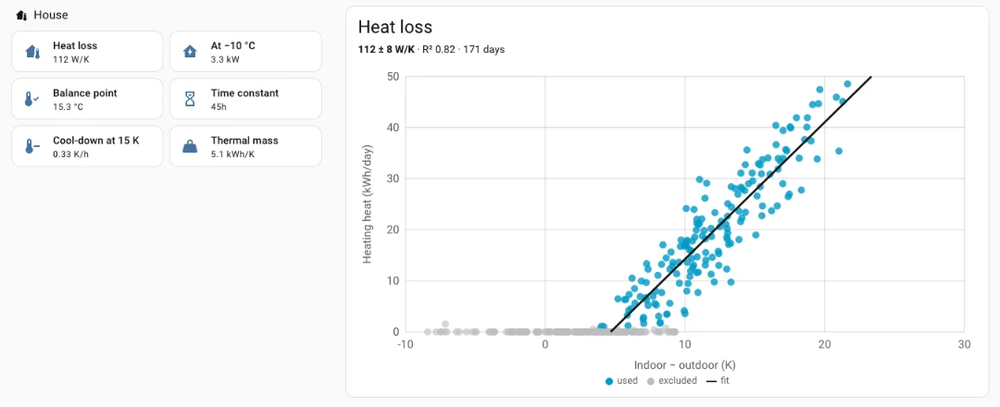
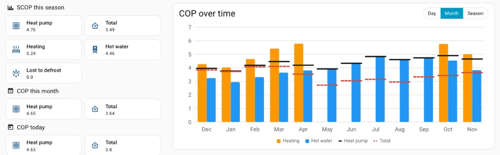
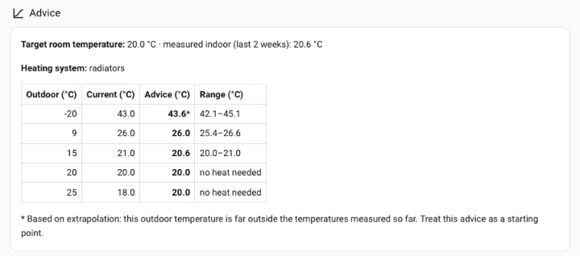
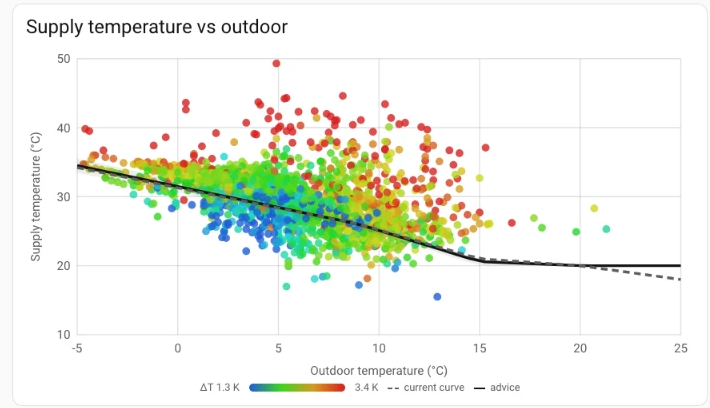
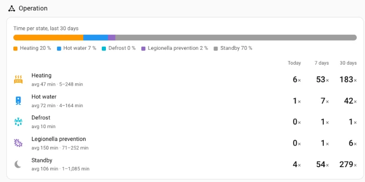
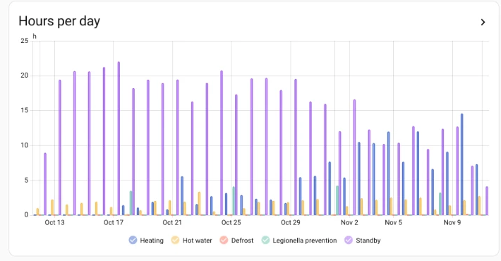

# Weheat Insights

> [!IMPORTANT]
> **Unofficial community project.** Weheat Insights is not affiliated with,
> endorsed by or supported by Weheat. Please don't contact Weheat support about it.

A Home Assistant integration that turns the data from the core
[Weheat integration](https://www.home-assistant.io/integrations/weheat/) into
insight, and ships its own dashboard. Everything runs locally in Home
Assistant: no external server, no accounts, no telemetry.

## Features

- A dashboard that builds itself, with no YAML. For each heat pump five tabs:
  - **Performance** (default): COP and SCOP per day, month and heating
    season, for the heat pump (as in the Weheat app) and in total (incl.
    standby and pumps), split into space heating and hot water; COP over
    time per day, month or season; what defrosting costs; energy per day.
  - **House**: heat-loss coefficient with confidence interval and scatter
    chart, heat loss at −10 °C, balance point, cool-down rate and thermal
    mass; degree days and heating per degree day compared with last season.
  - **House**: heat-loss coefficient, balance point, cool-down and thermal mass,
with one dot per day of heating against the indoor–outdoor difference.



**Heating curve**: advice for the five points of the Weheat heating
    curve (−20, 9, 15, 20 and 25 °C outdoor) that just keeps your target room
    temperature, next to your current curve if you enter it under Configure;
    supply temperature against outdoor temperature (up to 25 °C) with both
    curves; before/after comparison of a curve change, corrected for weather.
  - **Operation**: the operating state over the last 24 hours, how the last
    30 days were spent per state (heating, hot
    water, defrost, legionella prevention, standby), and per state the number
    of periods today / 7 / 30 days and their average length, with periods and
    running hours per day (standby left out) as bar charts and defrosts next
    to degree days.
  - **Hot water** (when the pump has a hot-water tank): the temperature the
    tank was heated to per day (the highest temperature of the bottom
    sensor, next to the set target), tank top and bottom over the last 48
    hours, hot-water heat and electricity per day, COP against tank temperature and against
    outdoor temperature, at what time of day the tank is heated, and the
    tank's standing loss per week.
  - **Live**: operating state, COP gauge (while running), room and target
    temperature, outdoor, supply and return temperatures, ΔT, electrical
    power and heat output,
    graphs for the last 24 hours (water and air temperatures apart, power,
    ΔT) and hourly water and air temperatures for the last 7 days.
- Sensors, all on a separate "Weheat Insights" device per heat pump:
  - ΔT supply/return.
  - COP today, COP this month and SCOP this season: heat pump, total,
    heating and hot water; COP lost to defrost and heat taken by defrost.
  - Degree days this month and season; heating per degree day this season,
    the same period last season and the whole of last season.
  - Heat-loss coefficient, heat loss at −10 °C, balance point, cool-down time
    constant, cool-down rate and thermal mass.
  - Heating-curve advice for each Weheat curve point; heating electricity per
    degree day before and after a curve change.
  - Per operating state: periods today (with statistics for 7 and 30 days)
    and running totals of periods and hours.
- Five custom cards you can also use on your own dashboards (see below).
- Works from day one with your existing history: everything is computed from
  Home Assistant's long-term statistics of the core Weheat energy counters.
- Works with multiple heat pumps. English and Dutch.

## Screenshots

**Performance**: SCOP this season, COP this month and today, and COP over
time per month for heating, hot water, the heat pump and in total.



**Heating curve**: advice for each point of the Weheat curve with its range,
next to the curve you entered.



Every dot is an hour of heating: supply temperature against outdoor
temperature, coloured by the supply–return difference, with the advised and
your current curve.



**Operation**: how the last 30 days were spent and how often and how long
each state ran, with hours per state per day.





## Requirements

- Home Assistant 2026.10 or newer.
- The core **Weheat** integration, set up and working.

## Installation

### HACS (recommended)

1. In HACS, open the menu → **Custom repositories**, add
   `https://github.com/frenkel/ha-weheat-insights` with type **Integration**.
2. Install **Weheat Insights** and restart Home Assistant.

### Manual

Copy `custom_components/weheat_insights` into your `config/custom_components/`
folder and restart Home Assistant.

## Setup

1. Go to **Settings → Devices & services → Add integration → Weheat Insights**.
2. Pick the heat pump to analyse.
3. Choose the outdoor temperature sensor (default: the heat pump's own
   air-inlet sensor) and, optionally, an indoor temperature sensor.

Repeat for each heat pump. Everything can be changed later; see
[Settings](#settings).

### Dashboard

Create a new dashboard (**Settings → Dashboards → Add dashboard → New
dashboard from scratch**), open it, choose **Edit → ⋮ → Raw configuration
editor** and replace the contents with:

```yaml
strategy:
  type: custom:weheat-insights
```

The dashboard updates itself when you add heat pumps or when sensors change.

> [!TIP]
> If the dashboard says *"Timeout waiting for strategy element
> ll-strategy-dashboard-weheat-insights"*, your browser is still showing a page
> from before the install or update. Do a hard refresh (Ctrl/Cmd + Shift + R);
> in the companion app, use *Settings → Companion app → Debugging → Reset
> frontend cache*.

The integration serves the dashboard code itself, so you don't need a
separate frontend install.

Negative values in the power graph are defrost cycles: the heat pump briefly
takes heat back from the heating water to thaw the outdoor unit. They are
real and are kept on purpose.

### Cards for your own dashboards

The dashboard uses five cards that you can also add to any other dashboard.
You find the `entry_id` by opening **Settings → Devices & services → Weheat
Insights**: the address bar then ends in `#config_entry=<entry_id>`.

```yaml
# COP per day, month or season (heat pump and total, heating and hot water)
type: custom:weheat-insights-performance-card
entry_id: <entry_id>
period: month          # day, month or season

# Heat loss of the house (one dot per day, with the fitted line)
type: custom:weheat-insights-scatter-card
entry_id: <entry_id>
mode: heat_loss

# Supply temperature against outdoor temperature, coloured by ΔT,
# with the advised heating curve
type: custom:weheat-insights-scatter-card
entry_id: <entry_id>
mode: supply_curve
days: 365

# Hot water: summary, cop_target, cop_outdoor, start_hours or
# standing_loss; days sets how many days a scatter chart shows
type: custom:weheat-insights-dhw-card
entry_id: <entry_id>
mode: cop_target
days: 90

# Time per operating state and number and length of periods
# (the operating sensors of the "Weheat Insights" device)
type: custom:weheat-insights-operating-card
entities:
  heating: sensor.<pump>_weheat_insights_heating_periods_today
  dhw: sensor.<pump>_weheat_insights_hot_water_periods_today
  defrost: sensor.<pump>_weheat_insights_defrost_periods_today
  legionella: sensor.<pump>_weheat_insights_legionella_prevention_periods_today
  standby: sensor.<pump>_weheat_insights_standby_periods_today
```

The operating card needs the entity ids of the "periods today" sensors; look
them up on the Weheat Insights device, since they depend on your language
and device name.

## How the numbers are calculated

- **Heat pump COP/SCOP** = all useful heat ÷ compressor electricity for
  heating, hot water and defrost. This is the same number the Weheat app
  shows.
- **Total COP/SCOP** = the same heat ÷ all electricity, so also standby and
  the indoor unit (circulation pumps). This is what your heat actually
  costs. The total COP sensors list in their attributes where the
  electricity went (heating, hot water, defrost, standby, indoor unit).
- **Heating** and **hot water COP** count only the compressor electricity for
  that mode, plus its share of defrost. The core Weheat integration reports
  defrost as one combined counter, so defrost electricity and the heat taken
  back during defrost are split in proportion to the heating and hot-water
  electricity. Standby and the indoor unit are left out of these two.
- **COP lost to defrost** = COP without defrost − COP with defrost.
- **Degree days** per day = max(0, base − mean outdoor temperature), base
  18 °C by default, weighted by default with the Dutch convention (Nov–Feb
  ×1.1, Mar/Oct ×1.0, Apr–Sep ×0.8). Weighting can be switched off.
- **Heating per degree day** uses space-heating heat only (hot water does not
  depend on the weather), so you can compare a mild and a cold winter.
- The **heating season** runs from September up to and including May by
  default. Out of season, "this season" shows the season that just ended.
- A COP is only shown when at least 0.5 kWh of electricity was used in the
  period, so a quiet day doesn't show a meaningless value.
- Figures can lag up to about an hour: the core counters update every 30
  minutes and statistics are compiled hourly.

### House analysis

- **Heat-loss coefficient H (W/K)**: a straight line through one point per
  day, heating heat (kWh/day) against the average indoor − outdoor
  difference, over the last 12 months. H = slope × 1000 / 24. The line's
  offset is the free heat from sun, people and appliances.
- Days are left out when data is missing, the difference is below 3 K, there
  was less than 1 kWh of space heating (no heating needed, so nothing to
  learn about heat loss; as zeros they would flatten the line), the
  indoor temperature changed more than 1.5 K from the day before (the house
  was storing or releasing heat), or a gas boiler or electric heater ran
  (only detectable within the recorder's state history, 10 days by default).
- A result is shown once there are 14 usable days spanning at least 6 K,
  with a 95 % confidence interval and R². Without an indoor sensor 20 °C is
  assumed and flagged.
- **Heat loss at −10 °C** = H × (20 − (−10)). **Balance point**: the outdoor
  temperature at which the line reaches zero.
- **Cool-down**: periods of at least 4 hours without heating (hourly
  statistics) are fitted to an exponential decay. The median time constant
  τ gives the cool-down rate at 15 K difference and, with H, the thermal
  mass C = τ × H. A modulating heat pump that runs all night leaves few such
  periods, so this can take a while to appear.

### Heating-curve advice

The aim is one heating curve that keeps the house at your target room
temperature (default 20 °C, a setting) with water no warmer than needed:
lower water temperatures give a higher COP.

For each point of the Weheat curve:

1. **Heat demand** at that outdoor temperature, from the heat-loss fit at the
   target room temperature.
2. **The water temperature at which your heating system delivers exactly
   that heat.** The emitter law Q = k × (mean water − room)ⁿ is calibrated on
   hours of steady heating (heating in the hour and both neighbours, no hot
   water nearby) over the last 12 months, with n = 1.3 for radiators, 1.1 for
   underfloor heating and 1.2 for a mix (a setting). Half the measured
   supply−return difference at that heat is added.
3. Above the balance point no heat is needed; the advice there is the room
   temperature.

The advice is given with one decimal, which the Weheat web portal accepts;
in the app, which only takes whole degrees, round up so the house stays warm.
The range comes from the 95 % interval of the heat-loss coefficient. Points
far outside the outdoor temperatures you have measured are marked as
extrapolated.

The heating-curve chart shows the last 12 months, up to 25 °C outdoor (the
warmest point of the Weheat curve), the same hours the advice is
calibrated on, and only uses hours in which the pump mainly heated the
house (at least 0.5 kWh space heating, no hot water), and skips the hour after
hot water, when left-over DHW heat can be pushed into the heating circuit at a
high supply temperature.

Enter your current curve under **Configure** to see it next to the advice
(an extra "Current" column and a dashed line in the chart). Treat the advice
as a starting point, not a guarantee: change the curve in small steps and
check the rooms stay warm. When you then enter the new values under
**Configure**, the change date is stored automatically and the before/after
tiles compare heating electricity per degree day (and heating COP) for up to
60 days before and after.

### Operating states

Weheat Insights follows the core integration's operating state and stores
each completed period (kept for about 13 months). On first start it fills
in from the recorder's state history (10 days by default). Counted states
are heating, hot water, defrost, standby and legionella prevention (the
periodic heating of the hot-water tank to a high temperature). Rare states
such as a water check, self test or firmware update are not counted. Per state there is a summary
sensor (periods today; attributes with count, min/avg/max length, hours and
share for today, 7 and 30 days) and two running totals with long-term
statistics (number of periods and hours) for bar charts. The hours count a
running period as it goes, so a long standby period is spread over the hours
and days it lasted; a period counts as one in the hour it ends.

The core integration reports the state every two minutes, so lengths are
accurate to about two minutes and a very short defrost can be missed. Time
while Home Assistant was not running is counted in the state it was in
before.

### Hot water

- What the tank was **heated to** on a day is the highest temperature of the
  bottom sensor: the heat pump stops heating the tank once its bottom is at
  its target. On a legionella-prevention day that is the legionella
  temperature. Newer versions of the core integration also report the set
  target; when they do, its highest value of the day is drawn next to it.
- **Hot-water COP per day** = hot-water heat ÷ hot-water electricity plus
  its share of defrost, once at least 0.25 kWh was used that day.
- The **COP against tank temperature** and **against outdoor temperature**
  charts have one dot per day for the last 90 days, with a straight-line fit
  through the days without legionella prevention (through all days when it
  runs almost daily): it shows what each degree hotter in the tank, or colder
  outside, costs. Legionella days are drawn as hollow dots.
- **Standing loss** is how fast the top of the tank cools at night
  (00:00–07:00) in hours without a hot-water run, the hour after one, or a
  sudden drop from tapping (more than 1 K in an hour), in K/h; one figure per
  night and the median per week. It depends on the tank and on the room it
  stands in.
- The tank temperature and the energy per day are Home Assistant's own
  statistics graphs over 14 days; the standing-loss chart shows 12 weeks:
  more bars that go up and down are hard to read.
- Tank temperatures only have history since the core Weheat integration was
  added to Home Assistant.

### Long-term statistics

COP over time is calculated from the energy counters (the performance card),
never from averages of the COP sensors: an hourly average of a running ratio
means little. The COP/SCOP sensors do have `state_class: measurement`,
because without a unit or state class Home Assistant shows a state as text,
without your decimal separator. Estimate sensors (heat loss, advice) have no
`state_class`. The operating-state counters and the degree-day statistic
have long-term statistics, so their bar charts keep history.

## Settings

Under **Settings → Devices & services → Weheat Insights → Configure** you can
change:

- the outdoor and (optional) indoor temperature sensor;
- the heating season (start month and end month);
- the degree-day base temperature and whether degree days are weighted;
- the target room temperature for the heating-curve advice;
- the heating system: radiators, underfloor heating or both;
- your current Weheat heating curve (the five water temperatures from the
  app or portal), to compare it with the advice in the table and chart;
- the date of a heating-curve change, for the before/after comparison. It is
  filled in automatically when you change your current curve.

## How it works

Weheat Insights reads the sensors that the core Weheat integration creates.
It finds them through Home Assistant's device and entity registries, so
renaming entities is fine. Performance figures come from the recorder's
long-term statistics; degree days are also published as a long-term statistic
(`weheat_insights:degree_days_…`) for the statistics graph card. Operating
periods are stored in Home Assistant's own storage (`.storage/`). It does not
talk to the Weheat cloud and cannot control your heat pump.

## Development

See [docs/development.md](docs/development.md).

## License

[MIT](LICENSE)
